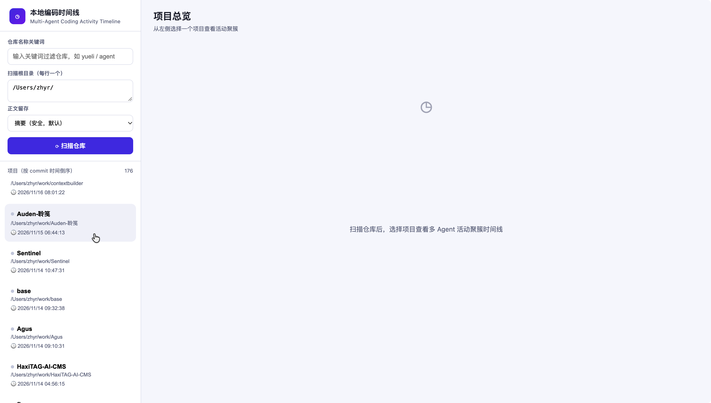
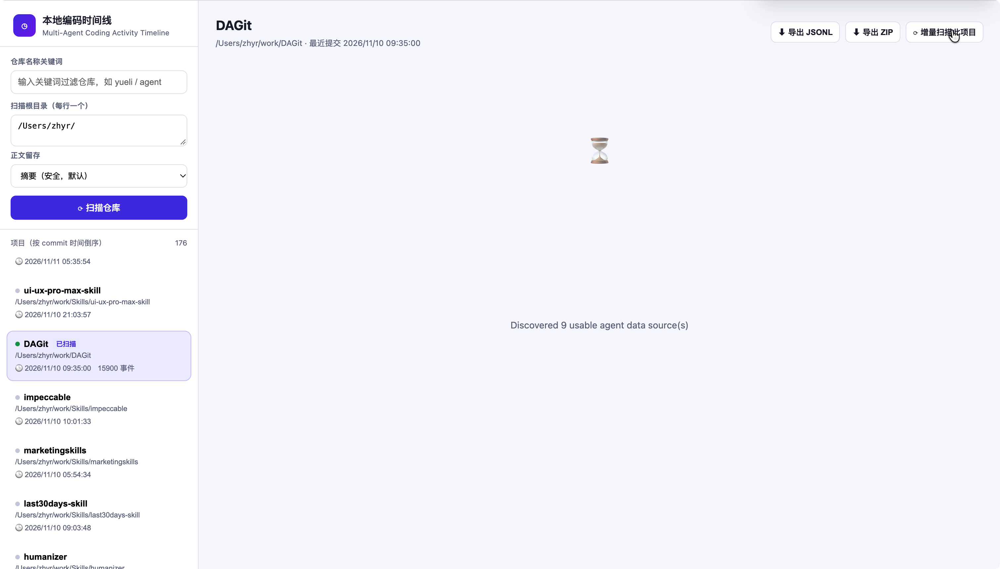
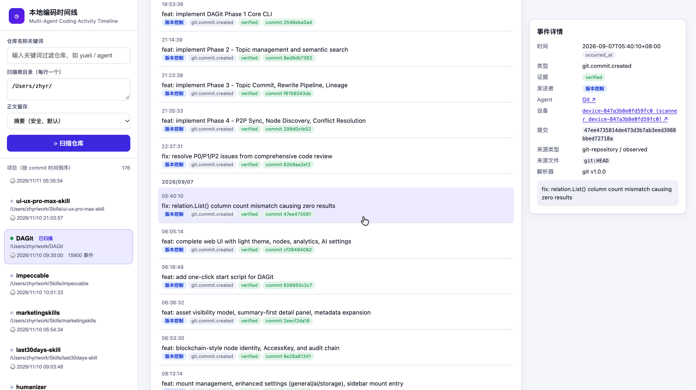
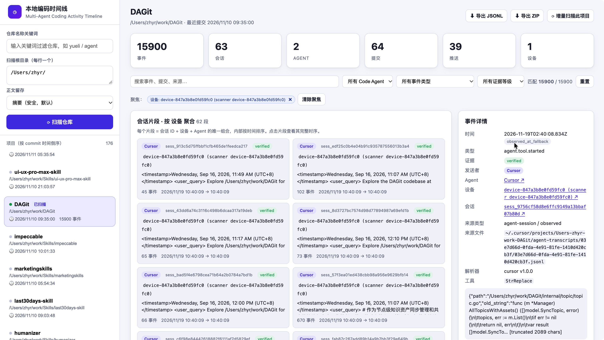

# aitimeline — Multi-Agent Coding Activity Timeline

**Version 1.0.0** · MIT License

[English](#english) · [中文](#中文)

`aitimeline` is a local-first, read-only CLI that reconstructs a unified, verifiable
development timeline for one project across AI coding agents, devices and Git history.
It ships as `@zhyr/ai-coding-timeline` and installs the `aitimeline` executable.

Source: <https://github.com/zhyr/multi-agent-coding-timeline>

---

## 界面预览 / Demo

The screenshots below follow the actual usage flow: discover repositories → scan a
project → read the unified timeline → drill down into conversation segments.
以下截图按实际使用动线排列：发现仓库 → 扫描项目 → 查看统一时间线 → 下钻会话片段。

**1. 发现并选择仓库 / Discover and select repositories**

左侧输入关键词过滤仓库名，点击「扫描仓库」按最近 commit 时间倒序列出本机项目；
正文留存模式（摘要 / 完整 / 仅元数据）也可在此选择。默认不会自动扫描任何数据。



*Filter repositories by keyword, order by latest commit time, and choose the content mode.*

**2. 扫描选中项目 / Scan the selected project**

在界面上选择项目后触发扫描（或「增量扫描此项目」）；扫描只读本地 Agent 数据源，
进度与发现的数据源数量会实时显示，结果落盘到本地目录供后续增量复用。



*Scanning is manual and read-only; packages are stored locally for incremental reuse.*

**3. 统一时间线与事件证据 / Unified timeline and event evidence**

同一项目的事件按时间重排，标注发送者、证据等级与 Agent；右侧详情面板展示来源文件、
设备、会话 ID、工具调用与正文。Agent / 设备 / 会话三个字段均可点击。



*Chronological events with sender, evidence level and a per-event provenance panel.*

**4. 会话片段聚合 / Conversation segments**

顶部 KPI 汇总事件、会话、Agent、提交与推送；点击 Agent / 设备 / 会话字段后，
按 `(sessionID, device, agent)` 三元组聚合成会话片段时序列表，可继续下钻到单个会话。



*Segments aggregated by (session, device, agent), ordered by time and drillable.*

> 截图来自本地实例 `aitimeline serve`。命令行用法见下文；交互式应用直接运行
> `aitimeline serve`，完整参数可用 `aitimeline serve --help` 查看。

---

# English

## What it answers

- What did I ask each agent, and what did the agent claim it did?
- Which tool calls and execution statuses are observable, and which are only agent-reported?
- Which Git commits and pushes are verified, and how do they relate to agent sessions?
- What happened on another machine if I bring back its agent data and its Timeline Package?

Everything is a snapshot produced by a manual command. There is no hook installation,
no background daemon, no watcher and no network access. Source records and Git
repositories are only ever read.

## Relationship with AI Exporter

This project is a **downstream application** of
[AI Exporter (`zhyr/Al-exporter`)](https://github.com/zhyr/Al-exporter), and the two are
complementary rather than competing:

| | AI Exporter (upstream) | aitimeline (this project, downstream) |
| --- | --- | --- |
| Role | Extracts and exports AI coding conversations from 26+ agents into a portable archive (`manifest.json`, per-thread JSON/Markdown, `interop.json`). | Reconstructs one project's activity into a unified, verifiable timeline and clusters it by project. |
| Primary question | "What did the agent and I say? Give me a portable copy / training data." | "What happened on this project, in what order, on which device, backed by what evidence?" |
| Output | Export archive, Markdown, JSON, training/eval formats (Transfer2Eval). | Timeline Package with evidence levels, provenance, SHA-256 integrity, offline viewer. |
| Identity | `thread_id`, `session.native_id`, `messages[].id`, `device.source_device_id`. | `dedup_key` + `content_hash` + provenance; `source_device_id` / `scanner_device_id` are separated. |

An AI Exporter archive is a supported **input source**: the built-in `al-exporter`
import adapter reads it in Mode B (`--source-root` + `manifest.json`, schema 1.0.0 / 1.1.0),
adopts the declared source device, and folds imported messages into native events at two
explicit levels (`deterministic` and `inferred`). Imported events are always
`agent_reported` / `derived` and carry no Git evidence — Git facts come exclusively from
this tool's own read-only Git Scanner. Import is optional: native agent logs
(`~/.codex`, `~/.cursor`, ...) are scanned directly and do not require AI Exporter.

The export contract is documented upstream in
[AI Exporter's README](https://github.com/zhyr/Al-exporter/blob/main/README.md)
("Interop Contract / 协同导出契约"); capability levels here are derived from its
`interop.json` non-empty rates, not from schema presence. Run `aitimeline adapters` for the
capability matrix and see the Al-exporter import notes under
[Known limitations](#known-limitations).

## Requirements

- Node.js **>= 22.5** (uses `node:sqlite` read-only access for Cursor metadata)
- Git on `PATH` (optional; a project without Git is still scannable)
- macOS, Linux or Windows; paths are normalized per platform

## Install from source

```bash
npm ci
npm run build
node bin/aitimeline.mjs --help
# optional: put `aitimeline` on PATH
npm link
```

## Quick start

### 1. Local scan (Mode A)

```bash
aitimeline scan \
  --project ~/work/my-project \
  --output ~/work/timeline.my-project \
  --content-mode summary
```

Reads agent data from well-known local locations (for example `~/.codex`, `~/.cursor`,
`~/.qoder`, `~/.trae`, `~/.workbuddy`) and the project's Git history. Only sessions whose
project evidence matches the target project are included; weaker matches are reported as
`candidate` and excluded by default.

### 2. Remote source scan (Mode B)

Copy or mount another device's agent data, then:

```bash
aitimeline scan \
  --project /mnt/laptop/work/my-project \
  --source-root /mnt/laptop/Users/alice \
  --source-device alice-laptop \
  --output ./from-alice.ai-timeline
```

`--source-device` is mandatory: the scanner hostname is never used as the source device
identity. Source files are read only, never modified or copied into the package.

Two device identities are kept separate everywhere: `device_id` (and the report's
`source_device_id`) is the device that owns the record, while `scanner_device_id` is the
machine that executed the scan. A remote scan records both; it never rewrites the source
device to the scanner hostname.

### 3. Merge (Mode C)

```bash
aitimeline merge ./from-alice.ai-timeline ./from-bob.ai-timeline \
  --output ./unified.ai-timeline --force
```

Inputs must share the same strong project identity. Name-derived identities are rejected
unless `--allow-weak-identity` is passed after manual confirmation.

### 4. Validate and inspect

```bash
aitimeline validate ./unified.ai-timeline
aitimeline inspect ./unified.ai-timeline --events 10
aitimeline report ./unified.ai-timeline
```

### 5. Render an offline viewer

```bash
aitimeline viewer ./unified.ai-timeline --output ./timeline.html
open ./timeline.html
```

One self-contained HTML file: search and filters by agent, device, event type, evidence and
session; a provenance panel for every event; sessions, commits, sources, adapter
verification, scan/merge warnings and preserved conflicts. No network requests, no server.

### 6. Optionally run the local web app

```bash
aitimeline serve
# http://127.0.0.1:8766
```

`serve` is not `viewer`: `viewer` writes one static HTML file, while `serve` runs a local
application for repository discovery, scanning, browsing and export. The server binds
`127.0.0.1` by default. A non-loopback bind is refused unless `--allow-remote` is passed, and
remote mode always requires an access token (generated when `--auth-token` is omitted). It
enforces a Host allowlist against DNS rebinding, same-origin checks, JSON-only state changes,
a 1 MiB request-body limit and strict project-id validation. It never serves arbitrary files
and never enables CORS.

## Commands

| Command | Purpose |
| --- | --- |
| `scan` | Build a device-level Timeline Package from agent records + Git |
| `merge` | Combine validated packages from multiple devices |
| `validate` | Check schema, references and SHA-256 integrity |
| `inspect` | Human/JSON summary of a package |
| `report` | Print the stored scan or merge report |
| `viewer` | Render a package to one offline HTML file |
| `serve` | Start the loopback-only interactive local web app |
| `adapters` | Show the honest adapter capability matrix |
| `version` | Show CLI, format, schema and runtime versions |

Full options and exit codes are available via `aitimeline <command> --help`.

## Timeline Package

```
manifest.json
project.json
devices.json
agents.json
sessions.jsonl
tasks.jsonl
events.jsonl
relations.jsonl
git/commits.jsonl
git/pushes.jsonl
sources/source-index.jsonl
sources/scan-inputs.json        # present for scans
reports/scan-report.json        # present for scans
reports/merge-report.json       # present for merges
reports/conflicts.jsonl
integrity/checksums.sha256
```

`integrity/checksums.sha256` covers every generated file except itself. `validate` fails on
any content change.

Package compatibility: this release writes and reads `ai-coding-timeline` format/schema
`1.0.0`; `validate`, `inspect`, `merge` and `viewer` reject unknown format or schema versions
instead of guessing. Additive optional fields (for example new report counters and
`correlation_id`) are backward compatible: packages written before they existed remain valid.

## Evidence, not assumptions

Every event carries `evidence.level` — `verified`, `agent_reported`, `inferred` or
`unknown` — plus `provenance` and the parser version.

- Git commits are `verified`. A push is `verified` only when a `update by push` reflog entry
  exists on a remote-tracking ref with a configured remote; a remote-tracking ref alone is
  `inferred`. Commit messages never count as push evidence.
- "Task complete" messages from an agent are `agent_reported`, never upgraded.
- WorkBuddy session starts, Trae memory summaries and Cursor transcript ordering are
  explicitly `inferred`/`agent_reported`, with notes.
- Candidate project matches are excluded by default and labelled when included. An ancestor
  `cwd` is a candidate, not a strong project match.
- Conflicting versions of the same source record are never discarded; both are kept and
  recorded in `reports/conflicts.jsonl`. When an Al-exporter import is folded into a native
  event, its source references are embedded in `provenance.paired_import_sources` and a
  content difference is explicitly flagged as `content_diverged` instead of being hidden.

## Adapter status (verified 2026-11-20 on this machine)

Level 0 = discovery only, 1 = fixture tested, 2 = real data verified, 3 = real data plus
boundary, incremental and error handling verified. Levels describe evidence, not ambition.

| Adapter | Level | Verification | Sessions seen | Notes |
| --- | --- | --- | --- | --- |
| `codex` | 3 | verified | 214 | JSONL + zstd, `input_text`/`output_text` bodies, `environment_context` filtered; `cwd` is a path hint so project identity is `partial`; tool calls partial |
| `cursor` | 3 | partially verified | 2,528 | 737,261 verified `tool_use` events; transcript rows carry no timestamps (SQLite session starts do); SQLite metadata read-only |
| `qoder` | 3 | verified | 8 | cwd/gitBranch/timestamps/tool blocks |
| `trae` | 2 | partially verified | 1 | memory summaries only; all events agent-reported |
| `workbuddy` | 2 | partially verified | 10 | security audit events, no conversation transcripts |
| `claude-code` | 1 | not testable | 0 | no local `~/.claude/projects`; synthetic fixtures only |
| `codebuddy` | 0 | discovery only | 0 | directory observed, no verified session format |
| `zcode` | 0 | not testable | 0 | no local installation |
| `opencode` | 2 | partially verified | 1 | `project/session/message/part` JSON; text parts only, no tool parts observed; multi-file sessions opt out of incremental reuse |
| `al-exporter` | 2 | partially verified | 30,863 | import only: explicit `--source-root` + `manifest.json`; schema 1.0.0 and 1.1.0; 1.1.0 adds session cwd/remote, message ids and a declared device |

Run `aitimeline adapters` for per-field capability levels. The same run discovered 0 real
Claude Code sessions and no ZCode installation; those rows are fixture-only or discovery-only
and are not claimed as supported parsers.

## Documentation

Detailed design documents and verification reports are internal engineering material and
are not published in this open-source repository. `docs/demo/` only holds the screenshots
used above.

## Development

```bash
npm run typecheck   # strict TypeScript
npm test            # vitest (unit + integration + CLI end-to-end)
npm run build       # emit dist/
npm run verify      # typecheck + tests + build
```

Node is required for all commands. Tests use synthetic fixtures in temporary directories;
no home directory data is read during the test suite. Real-data adapter verification was
performed separately, read-only; the counts in the table above come from that run.

## Known limitations

- Agent formats are unofficial and may change without notice. A parser failure is reported
  as a source error; it never fabricates events.
- Cursor transcript records carry no timestamps, so their `occurred_at` is empty and
  sorting falls back to `observed_at`.
- Claude Code and ZCode have no locally verified parser; they are not claimed as supported.
  CodeBuddy is discovery-only. OpenCode is verified for sessions/messages/text, but its tool
  and file-change records have not been observed.
- Al-exporter archives are import-only: a thread's `meta.project` is a path heuristic and is
  ignored, `meta.created_at` is a file mtime and is never used as event time, and imported
  events are `agent_reported`/`derived` with no Git evidence. Schema 1.0.0 and 1.1.0 are both
  accepted. 1.1.0 `session.native_id` is used directly (no path guessing), `session.cwd` and
  `session.git_remote` are real ProjectEvidence with their declaration source recorded, and
  `messages[].id` / `line` / `tool_call` drive event identity and tool events. A null
  `tool_call.status` stays unknown. 1.0.0 still recovers the native session id from
  `meta.file_path` (106 of 3,321 observed records: all real Codex/Cursor/Claude transcripts).
  Imports fold into native events at two labelled levels: **deterministic** when agent +
  native session id + native message id agree, and **inferred** (the 1.0.0 path) when agent +
  session id + type + time + content agree. Anything else stays as a separate variant; a real
  Cursor merge folded 0 imported events because Al-exporter stores the transcript as a single
  `system` message while the native adapter emits per-line events.
- Al-exporter capability levels come from `interop.json` actual non-empty rates, not from
  schema presence: `empty` and `absent` mean `unavailable`, and the raw matrix is copied into
  `agents[].capabilities.interop`. `manifest.device.source_device_id` is adopted as the source
  device only when `--source-device` is absent; a conflict is reported and the explicit CLI
  value wins.
- The 3-way "A+B+C" merge is the same operation as 2-way merge: it is deterministic and
  idempotent, but Git push evidence remains per-device and is never synthesized.
- Events remain device-scoped. Cross-device correlation never deletes records: the same Git
  object or native message id observed on multiple devices is folded deterministically into
  one primary event with `provenance.observers`, while content-only matches are marked
  `time_based_inference` / `candidate`, keep both events and carry a shared `correlation_id`.
  Conflicting variants stay in `reports/conflicts.jsonl`.
- Only manual runs are supported. Incremental state stores fingerprints only; unchanged
  session files are reused from the previous package, and any change forces a full re-parse.
- Content mode `full` may include prompts and code. `metadata_only` is recommended for
  anything that leaves your machine.

## License

MIT License — see [LICENSE](LICENSE). Copyright (c) 2026 zhyr.

---

# 中文

## 产品定位

`aitimeline` 是一个本地优先、只读的命令行工具，用于把同一个项目在多个 AI Coding Agent、
多台设备以及 Git 历史中留下的开发活动，重建为一条统一、可校验的时间线。npm 包名为
`@zhyr/ai-coding-timeline`，安装后提供 `aitimeline` 命令。

仓库地址：<https://github.com/zhyr/multi-agent-coding-timeline>

它回答这几类问题：

- 我对每个 Agent 提过什么要求？Agent 又声称自己做了什么？
- 哪些工具调用和执行状态是真实可观察的？哪些只是 Agent 自述？
- 哪些 Git 提交和推送经过验证？它们与哪些 Agent 会话相关？
- 如果把另一台设备的 Agent 数据和 Timeline 包带回来，那台机器上发生过什么？

所有产物都来自手动执行的命令快照。工具不安装 Git Hook，不常驻后台，不监听文件变化，
也不访问网络；源记录与 Git 仓库始终只读。

## 与 Al-exporter 的关系

本项目是 [AI Exporter（`zhyr/Al-exporter`）](https://github.com/zhyr/Al-exporter) 的**下游应用**，
二者定位互补，而非相互替代：

| | AI Exporter（上游） | aitimeline（本项目，下游） |
| --- | --- | --- |
| 角色 | 从 26+ 种 Agent 中抽取并导出对话，生成可移植归档（`manifest.json`、逐会话 JSON/Markdown、`interop.json`）。 | 把同一个项目的活动重建为统一、可校验的时间线，并按项目聚簇。 |
| 核心问题 | 「Agent 和我说了什么？给我一份可移植副本 / 训练数据。」 | 「这个项目发生过什么、按什么顺序、在哪台设备、有什么证据支撑？」 |
| 产物 | 导出归档、Markdown、JSON、训练/评估格式（Transfer2Eval）。 | Timeline 包：证据等级、provenance、SHA-256 完整性校验、离线 Viewer。 |
| 身份标识 | `thread_id`、`session.native_id`、`messages[].id`、`device.source_device_id`。 | `dedup_key` + `content_hash` + provenance；`source_device_id` 与 `scanner_device_id` 分离。 |

AI Exporter 的归档是本工具**支持的一种输入源**：内置的 `al-exporter` 导入适配器在模式 B
（`--source-root` + `manifest.json`，schema 1.0.0 / 1.1.0）读取归档，采用其声明的源设备身份，
并把导入消息按 `deterministic` / `inferred` 两级折叠进原生事件。导入事件一律为
`agent_reported` / `derived`，不含 Git 证据——所有 Git 事实都来自本工具自带的只读 Git
Scanner。导入是可选的：原生 Agent 日志（`~/.codex`、`~/.cursor` 等）会被直接扫描，
无需先运行 AI Exporter。

导出契约由上游 [AI Exporter README](https://github.com/zhyr/Al-exporter/blob/main/README.md)
的「协同导出契约 / Interop Contract」定义；此处的能力等级依据 `interop.json` 的实际非空率，
而非 schema 中是否存在该字段。能力矩阵可运行 `aitimeline adapters` 查看，导入说明见
[已知限制](#已知限制)。

## 环境要求

- Node.js **>= 22.5**（读取 Cursor 元数据时使用 `node:sqlite` 的只读能力）
- `PATH` 中可用的 Git（可选；没有 Git 的项目同样可以扫描）
- macOS、Linux 或 Windows；路径按平台做归一化

## 从源码安装

```bash
npm ci
npm run build
node bin/aitimeline.mjs --help
# 可选：把 aitimeline 放进 PATH
npm link
```

## 快速开始

### 1. 本机扫描（模式 A）

```bash
aitimeline scan \
  --project ~/work/my-project \
  --output ~/work/timeline.my-project \
  --content-mode summary
```

工具会从本地常见目录读取 Agent 数据（例如 `~/.codex`、`~/.cursor`、`~/.qoder`、
`~/.trae`、`~/.workbuddy`），并读取目标项目的 Git 历史。只有项目证据能够匹配目标项目的
会话才会进入正式时间线；证据较弱的匹配会标记为 `candidate`，默认不纳入。

### 2. 跨设备源扫描（模式 B）

先把另一台设备的 Agent 数据复制或挂载到本机，然后执行：

```bash
aitimeline scan \
  --project /mnt/laptop/work/my-project \
  --source-root /mnt/laptop/Users/alice \
  --source-device alice-laptop \
  --output ./from-alice.ai-timeline
```

`--source-device` 为必填项：工具绝不会用扫描机的 hostname 推断数据所属设备。源文件只读，
不会被修改，也不会被复制进 Timeline 包。

所有位置都区分两个设备身份：`device_id`（报告中的 `source_device_id`）表示记录所属的
源设备，`scanner_device_id` 表示实际执行扫描的机器。远程扫描会同时保留两者，绝不会把
源设备改写成扫描机。

### 3. 多设备合并（模式 C）

```bash
aitimeline merge ./from-alice.ai-timeline ./from-bob.ai-timeline \
  --output ./unified.ai-timeline --force
```

参与合并的包必须具有相同的强项目身份。仅由项目名推导出的弱身份默认会被拒绝；人工确认后
可显式传入 `--allow-weak-identity` 放行。

### 4. 校验与查看

```bash
aitimeline validate ./unified.ai-timeline
aitimeline inspect ./unified.ai-timeline --events 10
aitimeline report ./unified.ai-timeline
```

### 5. 生成离线 Viewer

```bash
aitimeline viewer ./unified.ai-timeline --output ./timeline.html
open ./timeline.html
```

输出是单个自包含 HTML 文件：支持按 Agent、设备、事件类型、证据等级和会话检索与过滤；
每个事件都有来源面板；同时展示会话、提交、数据源、适配器验证状态、扫描/合并告警，以及
被保留的冲突记录。不发起任何网络请求，也不需要启动服务。

### 6. 可选：启动本地 Web 应用

```bash
aitimeline serve
# http://127.0.0.1:8766
```

`serve` 与 `viewer` 不同：`viewer` 只生成一个静态 HTML 文件，`serve` 运行一个用于仓库
发现、扫描、浏览和导出的本地应用。服务默认绑定 `127.0.0.1`；除非显式传入
`--allow-remote`，否则拒绝绑定非 Loopback 地址，且远程模式始终要求访问令牌（未提供
`--auth-token` 时自动生成）。服务会校验 Host 允许列表以防 DNS Rebinding、检查同源、
只接受 JSON 状态变更、限制请求体为 1 MiB，并严格校验 Project ID。它不会提供任意文件
读取，也不会开启 CORS。

## 命令一览

| 命令 | 用途 |
| --- | --- |
| `scan` | 从 Agent 记录 + Git 生成设备级 Timeline 包 |
| `merge` | 合并来自多台设备的、已通过校验的 Timeline 包 |
| `validate` | 校验 Schema、引用关系与 SHA-256 完整性 |
| `inspect` | 以人类可读或 JSON 形式输出包的摘要 |
| `report` | 打印包内保存的扫描报告或合并报告 |
| `viewer` | 把包渲染成一个离线 HTML 文件 |
| `serve` | 启动仅绑定 Loopback 的交互式本地 Web 应用 |
| `adapters` | 展示真实的适配器能力矩阵 |
| `version` | 显示 CLI、格式、Schema 与运行时版本 |

完整参数与退出码可通过 `aitimeline <命令> --help` 查看。

## Timeline 包结构

```
manifest.json
project.json
devices.json
agents.json
sessions.jsonl
tasks.jsonl
events.jsonl
relations.jsonl
git/commits.jsonl
git/pushes.jsonl
sources/source-index.jsonl
sources/scan-inputs.json        # 扫描产物中存在
reports/scan-report.json        # 扫描产物中存在
reports/merge-report.json       # 合并产物中存在
reports/conflicts.jsonl
integrity/checksums.sha256
```

`integrity/checksums.sha256` 覆盖除自身以外的所有生成文件；任何内容改动都会让
`validate` 失败。

包兼容性：本版本读写的 `ai-coding-timeline` 格式/Schema 均为 `1.0.0`；`validate`、
`inspect`、`merge` 与 `viewer` 遇到未知格式或 Schema 版本会直接拒绝，不做猜测。新增的
可选字段（例如报告计数器与 `correlation_id`）向后兼容：旧版本写出的包仍然有效。

## 以证据为准，不做假设

每个事件都带有 `evidence.level`（`verified`、`agent_reported`、`inferred` 或 `unknown`），
并保留 `provenance` 与解析器版本。

- 有真实 Git 提交记录支撑的是 `verified`；推送只有在配置了 remote 且 reflog 存在
  `update by push` 记录时才是 `verified`，仅有远端跟踪引用只能是 `inferred`。commit message
  不会被当作推送证据。
- Agent 自称的“任务完成”一律标记为 `agent_reported`，不会被提升等级。
- WorkBuddy 的会话开始时间、Trae 的记忆摘要、Cursor 转录顺序，明确标注为
  `inferred`/`agent_reported`，并附说明。
- 仅达到候选级别的项目匹配默认排除；被纳入时会明确标注。祖先目录形式的 `cwd` 只算候选。
- 同一条源记录出现冲突版本时不会丢弃任何一方，两者都会保留并写入
  `reports/conflicts.jsonl`。导入记录被折叠进原生事件时，其来源引用会嵌入
  `provenance.paired_import_sources`；内容差异用 `content_diverged` 显式标注。

## 适配器状态（2026-11-20 在本机实测）

等级 0 = 仅目录发现，1 = 合成样本验证，2 = 真实数据验证，3 = 真实数据 + 边界、增量与
异常处理验证。等级表示证据强度，不代表规划。

| 适配器 | 等级 | 验证状态 | 实测会话数 | 说明 |
| --- | --- | --- | --- | --- |
| `codex` | 3 | verified | 214 | JSONL + zstd，解析 `input_text`/`output_text` 正文并过滤 `<environment_context>`；`cwd` 只是路径线索，项目识别为部分支持；工具调用部分支持 |
| `cursor` | 3 | partially verified | 2,528 | 实测 737,261 条已验证的 `tool_use` 事件；转录记录无时间戳（SQLite 会话开始记录有时间戳）；SQLite 元数据只读 |
| `qoder` | 3 | verified | 8 | 提供 cwd/gitBranch/时间戳/工具块 |
| `trae` | 2 | partially verified | 1 | 仅有记忆摘要；全部事件为 agent-reported |
| `workbuddy` | 2 | partially verified | 10 | 安全审计事件，无对话转录 |
| `claude-code` | 1 | not testable | 0 | 本机无 `~/.claude/projects`，仅用合成样本测试 |
| `codebuddy` | 0 | discovery only | 0 | 只观察到目录，未验证会话格式 |
| `zcode` | 0 | not testable | 0 | 本机未安装 |
| `opencode` | 2 | partially verified | 1 | `project/session/message/part` JSON；仅观察到 text part，未观察到工具调用；多文件会话不参与增量复用 |
| `al-exporter` | 2 | partially verified | 30,863 | 仅导入：必须显式 `--source-root` + `manifest.json`；兼容 schema 1.0.0/1.1.0；1.1.0 提供 session cwd/remote、消息 id 与声明的设备 |

字段级能力等级可运行 `aitimeline adapters` 查看。同一次实测发现 0 个真实 Claude Code
会话，且本机未安装 ZCode；这两行分别只是合成样本与目录发现，不宣称解析支持。

## 文档

详细设计文档与验证报告属于内部工程资料，不随本开源仓库发布；`docs/demo/` 目录仅存放上述截图。

## 开发

```bash
npm run typecheck   # 严格 TypeScript 类型检查
npm test            # vitest（单元 + 集成 + CLI 端到端）
npm run build       # 输出 dist/
npm run verify      # typecheck + 测试 + 构建
```

所有命令都依赖 Node。测试只使用临时目录中的合成样本，不会读取用户主目录中的真实数据。
真实数据的适配器验证是另外单独执行的，全程只读，上表中的实测数量即来自该次验证。

## 已知限制

- Agent 的数据格式并非公开契约，可能随时变化。解析失败会作为数据源错误上报，绝不会
  凭空构造事件。
- Cursor 的转录记录没有时间戳，因此其 `occurred_at` 为空，排序时回退到 `observed_at`。
- Claude Code、ZCode 在本机没有经过验证的解析器，因此不宣称已支持；CodeBuddy 仅做到目录发现。
  OpenCode 已验证会话/消息/文本解析，但其工具调用与文件变更记录尚未观察到。
- Al-exporter 归档只支持导入：`meta.project` 是路径启发式字段，会被忽略；`meta.created_at`
  是文件 mtime，绝不作为事件时间；导入事件只能是 `agent_reported`/`derived`，不含 Git
  证据。兼容 schema 1.0.0 与 1.1.0：1.1.0 直接使用 `session.native_id`（不再反推路径），
  `session.cwd` / `session.git_remote` 作为真实 ProjectEvidence 并记录声明来源，
  `messages[].id` / `line` / `tool_call` 决定消息身份与工具事件；`tool_call.status` 为 null
  时保持未知。1.0.0 仍在 `meta.file_path` 命中原生布局时还原 native session id（实测
  3,321 条记录中 106 条）。折叠分为两级并明确标注：agent + native session id + 消息 id
  全等时为 **deterministic**；1.0.0 或缺少消息 id 时，只有 agent、session id、事件类型、
  时间与内容全部一致才做 **inferred**（推断配对）。其余情况保留为独立变体。真实 Cursor
  合并中导入事件折叠 0 条，因为 Al-exporter 把整份 transcript 导出为一条 `system` 消息，
  而原生适配器按行产出事件。
- Al-exporter 的能力等级按 `interop.json` 的实际非空率填写，而不是看 schema 是否存在：
  `empty` / `absent` 一律视为 `unavailable`，原始矩阵会写入
  `agents[].capabilities.interop`。只有当未提供 `--source-device` 时才采用
  `manifest.device.source_device_id`；两者冲突时会报告，并以显式 CLI 值为准。
- “A+B+C” 三方合并与两方合并是同一套操作：结果确定且幂等；但 Git 推送证据始终按设备
  独立记录，不会被合成。
- 事件始终按设备保留。跨设备关联从不删除记录：同一 Git 对象或原生消息 id 在多台设备被
  观察时，会确定性地折叠为一个主事件并在 `provenance.observers` 中保留观察设备；仅内容
  相似的匹配标记为 `time_based_inference` / `candidate`，两条事件都保留并共享
  `correlation_id`。冲突变体保存在 `reports/conflicts.jsonl`。
- 仅支持手动执行。增量状态只保存文件指纹：未变化的会话文件复用上一次包中的结果，一旦
  文件变化则重新完整解析。
- `full` 内容模式可能包含提示词和代码；任何要离开本机的包建议使用 `metadata_only`。

## 许可证

MIT License，详见 [LICENSE](LICENSE)。Copyright (c) 2026 zhyr。
